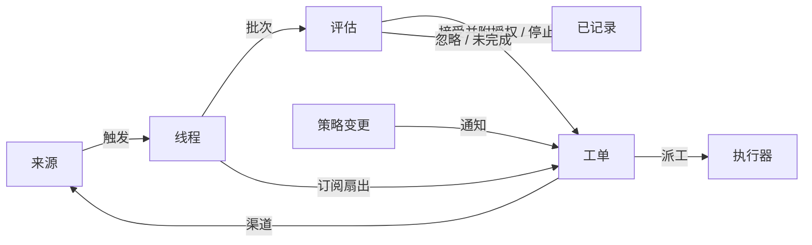

# 001 领域模型

本文命名 dsh-superagent 的各个概念，以及每个概念需要遵守的规则。代码、智能体调用的工具、面板以及其余文档，都只使用这些术语，不用别的词。遵循 [000 设计理念](000-philosophy-zh.md)，模型只保留工作真正需要的概念，而一个业务需求会成为其中某个概念的一个属性。

## 流程

工作从触发流向评估，再流向执行。来源产生触发。一个触发会作为上下文扇出到订阅了它所属线程的工单。沿着这条路径抵达某个工单的人的消息，就留在这个工单上；其他所有触发都进入评估，由评估判断它是否要求新的工作。评估接受时，会创建一个带有授权的工单。派工把工单交给执行器，结果则通过渠道回到来源。

## 概念

来源、触发、线程、评估、授权和订阅构成核心领域；其余概念为它们提供支撑。

| 概念 | 定义 | 所守规则 | 存在理由 |
| --- | --- | --- | --- |
| 来源 Source | 一条事件流。来源的"种类"是可复用的实现；来源的"实例"是某个种类的一份配置：是否运行，以及监听什么 | 持有自己的读取位置和自己的机器人身份。定义什么算作一个事件，包括那些只有随时间推移才成立的条件。在进入领域之前，先丢弃机器人自己的消息，以及超出其监听范围的触发。把每个触发翻译成它所属的线程，以及回复时使用的渠道地址 | 重启之后绝不能重放事件 |
| 触发 Trigger | 一个不可变事件，附带来源自身的元数据，例如其操作者 | 归属于一个或多个线程。同一个触发被接受两次，只产生一个工单 | 审计与幂等的单位 |
| 线程 Thread | 按时间顺序排列的触发；由来源定义哪些触发构成同一个线程 | 同一时刻至多有一个评估在其上运行。它可以有多个工单。它持有自己的订阅、正在运行的评估，以及决定历史 | 为评估提供一致的视图与上下文 |
| 关联 Correlation | 同一个触发所归属的多个线程之间的关系 | 只补充上下文；绝不负责路由 | 让评估能够追踪相关的证据 |
| 渠道 Channel | 线程的写入侧；由来源定义其地址 | 一个线程可以有多个渠道；一个工单持有一组渠道 | 确认、回复、pull request 和已处理的评审，本质上都是写入 |
| 策略 Policy | 带版本的受理规则，以及每个来源各自的部分：谁能通过该来源发起工作、以该来源自己的身份、该名单如何同步，以及哪些机器人可以提出候选 | 策略版本涵盖规则、接受模式和来源部分。会影响到活跃工单的变更——例如它所依据的某条规则发生变更——会被投递到它的派工；但不会收回授权。不同来源上的身份之间，永不互相映射 | 规则变更时，正在运行的评估必须被废弃 |
| 评估 Eval | 对一批触发做出的判断，分两层：准入与研判 | 输入：触发批次、线程快照、该线程上的所有工单（含已结束的），以及当前策略。输出：一个决定。不持有任何状态 | 决定新工作是启动、继续还是停止 |
| 授权 Mandate | 一次接受所授予的内容：策略版本、范围、强度、命中的规则、发送者在该来源上的身份，以及来源接收该触发的方式 | 不可变；范围更宽就意味着新工单。工单结束并不终止授权：只有人发出的停止才会收回它，而不再支持它的策略会撤销它。已结束的工单恢复之前，要针对当前策略重新校验 | 说明工作为何可以做，以及可以做多远 |
| 工单 Ticket | 一个已获授权的工作单元 | 只有评估能创建它。它引用自己的授权；持有自己的渠道与输入。状态从开启走向结束，当人的消息出现在它的某个线程上时回到开启状态——除非是人主动停止了它。它定义自己的状态，而不跟随执行器的状态 | 拥有执行过程及其报告 |
| 派工 Assignment | 把一个工单绑定到一个执行器实例 | 一个工单随时间会有多次派工。状态独立于工单，从待启动走向执行中、再到已结束。只有它的最终报告，才能在执行器一侧结束该工单 | 执行器在领域之外，但"由谁执行"必须在领域之内 |
| 订阅 Subscription | 工单与线程之间的多对多关系，由线程持有 | 匹配的触发会扇出到每一个活跃的已订阅工单，且不检查发送者是谁；以这种方式抵达工单的人的消息，不经过评估。执行器为获取上下文而跟随的线程，也以同样方式抵达其工单，但不为其授予权限，也不会恢复它。已结束的工单保留它的订阅，包括已关闭或已合并的 pull request 所对应的订阅：人的消息会在同一授权下恢复它，无需评估或决定；来自机器人和 CI 的消息不会抵达它，因为其执行器在恢复时会重新读取它的线程。被人停止的工单不接收任何内容。主 Session 只有在某条消息明确指向某个工单时，才会把线程挂到该既有工单上。人可以丢弃线程上的全部订阅；执行器只能丢弃自己工单对某个它认为无关的线程的订阅，但工单起步时所在的线程、以及来源让它跟随的线程（例如它的 pull request）除外 | 后续讨论无需任何人再次提及智能体，就能抵达执行器 |

"人"不是一个领域概念。触发会携带其操作者的标识符，形式由来源给出。许可名单是策略中属于某个来源的部分，使用该来源自己的身份。同一个人在多个来源上都持有账号，这件事属于提示词文本，由智能体在需要时阅读。

执行器及其会话和目录位于领域之外，通过派工与领域相连。

聚合：来源持有它的读取位置。线程持有它的订阅、正在运行的评估（串行执行，期间到达的触发合并进下一批），以及它的决定历史。工单持有它的派工、渠道和输入，并通过 id 引用决定。

## 已否决的概念

| 已否决 | 理由 |
| --- | --- |
| 把主体或成员资格作为实体，或在多个来源之间映射身份 | 人只是触发的元数据；许可名单是策略中属于某个来源的部分；跨来源的映射是提示词文本 |
| 让评估自行调度延迟触发 | 需要等待的条件本身就是一个普通来源，因此评估绝不会反过来依赖来源 |
| 评估的"等待中"或"已撤销"状态 | 等待属于来源；一个超时的评估会把它的触发重新排队，或以 `unavailable` 结束 |
| 每个线程至多一个活跃工单 | 一个线程可以承载多项彼此独立的工作；研判通过工单列表来避免重复 |
| 一种"追加到工单"的决定 | 追加属于订阅扇出，不需要评估 |
| 对订阅做准入检查 | 订阅覆盖整个线程；授权把"权限"与"上下文"分开 |
| 让关联负责路由 | 订阅负责路由；关联只补充上下文 |
| 让工单状态跟随 DSH Session | 工单可以被移交、被恢复，或由多个执行器运行，因此它定义自己的状态 |
| 由执行器声明"有人要求它停止" | 只有评估能决定一次结束的强度 |
| 策略变更时取消正在运行的工单 | 被取消的变更会留下半成品；正确做法是记录并投递这次变更 |
| 执行器会话失败或阻塞时，锁死它的全部工具 | 这会拒绝人直接在会话中操作，也会拒绝恢复后的报告；只要暂停自动输入就够了 |
| 从报告的自由文本推断"正在等待人" | 分类需要结构化的事实；执行器通过结构化字段来提问 |

## 哪些是可复用的

上述概念及其规则是可复用的。来源实现、策略内容、执行器与渠道实现，则属于某一次具体部署。每个来源在内部保留自己的用语，例如消息、聊天或通知，并负责把它们翻译成触发。

| 部分 | 本仓库中的对应物 |
| --- | --- |
| 来源 | 飞书：实时事件、历史回溯、对已订阅话题的轮询。GitHub：通知、已订阅的 Issue 和 pull request、CI 变更、已合并或已关闭的 pull request，以及在开启时包含仓库中每个新 Issue、新 pull request、新评论和默认分支的 CI |
| 策略 | 受理规则，以及每个来源的许可名单、同步方式、机器人名单和准入表 |
| 执行器 | 每个工单一个 DSH 执行器 Session 和一个目录，运行在执行环境中——环境变量由执行器和各来源注册 |
| 渠道 | 飞书话题回复、GitHub 评论和评审线程回复 |

## 术语表

这是一份参考清单，列出本文及后续文档使用的术语及其中文名；上文尚未引入的术语，会在后续文档中解释。面板一次只显示一种语言；它的 (?) 按钮会用双语打开这份术语表。智能体发给人的 GitHub 与飞书消息使用日常语言，不使用这些术语。

| 术语 | 中文 | 含义 |
| --- | --- | --- |
| Agent | 智能体 | dsh-superagent 运行的自动化团队成员，通过 GitHub 账号、飞书机器人等身份在来源上行动 |
| Main Session | 主 Session | 负责评估触发、接受并派发工单、以及回复的 DSH Session；在代码和提示词中名为 `orchestrator` |
| Executor Session | 执行器 Session | 执行器为单个工单运行的 DSH Session；在代码和提示词中名为 `worker` |
| Source | 来源 | 一条事件流：插件提供的一个"种类"，加上一份实例配置 |
| Trigger | 触发 | 来自某个来源的一个不可变事件 |
| Thread | 线程 | 按时间顺序排列的触发；评估在其中串行运行的单元 |
| Correlation | 关联 | 共享同一个触发的多个线程之间的关系；只补充上下文 |
| Channel | 渠道 | 线程的写入侧 |
| Policy | 策略 | 带版本的受理规则，以及每个来源在其中的部分，例如在该来源上谁可以请求工作 |
| Policy version | 策略版本 | 规则、来源部分与接受模式某一组合的标识符；每个授权都会记录它 |
| Eval | 评估 | 把一批触发转化成一个决定的过程 |
| Gate | 准入 | 评估中确定性的第一层：谁可以发起工作，以及以何种强度 |
| Assessment | 研判 | 评估过程中模型所做的判断 |
| Decision | 决定 | 评估的结果 |
| Mandate | 授权 | 一次接受所授予的内容：强度、范围，以及它所依据的策略版本 |
| Ticket | 工单 | 一个已获授权的工作单元 |
| Assignment | 派工 | 把一个工单绑定到一个执行器实例 |
| Subscription | 订阅 | 工单与线程之间的关系 |
| Fan-out | 扇出 | 把已订阅线程中的触发作为上下文投递给工单 |
| Executor | 执行器 | 运行派工的端口：每个工单一个执行器 Session 和一个目录 |
| Execution environment | 执行环境 | 执行器 Session 与 prepare 命令的运行环境：由执行器和各来源注册的变量，每个变量有一个键、一个值和一个描述 |
| Report | 报告 | 派工向它的工单汇报的状态 |
| Attention | 待人工决定 | 工单上等待人回答的问题 |
| Disposition | 去向 | 关于某个触发是被过滤、被评估还是被扇出的记录 |
| Input | 输入 | 投递给工单的上下文：扇出的触发、策略变更、恢复以及文本 |
| Scope | 范围 | 授权所允许的工作 |
| Strength | 强度 | 一个授权或一次评估的依据有多强 |

| 分组 | 取值 |
| --- | --- |
| Decision | accept 接单 · stop 停止 · ignore 忽略 · unavailable 未完成 |
| Strength | explicit 明确 · inferred 推断 |
| Assignment | pending 待启动 · running 执行中 · ended 已结束 |
| Report | progress 进展 · waiting 等待 · ready 就绪 · blocked 受阻 · failed 失败 · dropped 无需处理 |
