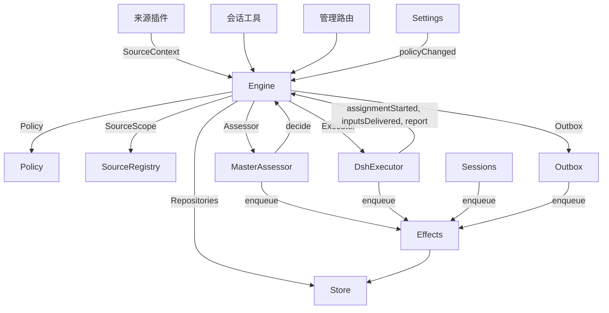

# 007 架构

这是面向开发者的实现指南。它把 [001 领域模型](001-domain-zh.md) 到 [006 部署](006-deployment-zh.md) 中的概念映射到类、接口与文件。请先读运行时与 Engine，然后把模块表和测试表当作代码索引使用。

## 核心类与胶合层

核心类在小接口之后掌管领域概念与外部边界。胶合层把工具参数、HTTP 请求、来源负载和 DeepSeek Harness 事件翻译成对这些类的调用，再把结果变回卡片、视图和消息。

`Runtime`（`src/app/runtime.ts`）构造整个应用、提供依赖，并掌管启动与关闭。`Engine` 构造自己内部的各个部分。执行器与研判器会回调 Engine，因此 Runtime 交给它们的是 getter，而不是要求以某个循环顺序构造。

### Runtime

`Runtime` 是组合根，其中没有任何领域规则。它的构造函数锁定状态目录、打开 Store，并逐个构建各组件。若构建失败，它会关闭 Store 并释放锁。

启动时会注册管理路由并执行 Setup。Setup 解析完成后，它会安装 Session 与执行器钩子、确保主 Session 存在、启动策略同步、恢复被中断的派工，并启动 pass 与 effect。`ready` 标记启动完成。

关闭时会取消各轮次、等待 pass、effect 与智能体、还原进程环境、关闭 Store 并释放锁。来源插件通过狭窄的 `SourceHost` 接口，把 Runtime 作为 `orchestrator` 服务注入。

| 部分 | 模块 | 作用 |
| --- | --- | --- |
| Setup | `src/app/setup.ts` | 按 worker shell 的运行方式探测各自的 CLI，从而解析仓库与账号；写入并应用 worker 的环境与命令 shim，并保留配置问题；设置页会通过它检查变更过的账号，并通过它重启——重启会再次运行 Setup |
| Passes | `src/app/passes.ts` | 一次只跑一个 pass，每两秒一次，任何命令也可以请求一次：先处理到期的 effect，再调用 `Engine.evaluateDue`；来源的触发就是经由它抵达 Engine 的 |
| Outbox | `src/app/outbox.ts` | Engine 的 `Outbox` 端口，也是回执的唯一写入者：`send` 在一个事务里保存消息回执并排入它的 `reply` effect，而该 effect 的处理程序通过 `SourceRegistry.send` 发出消息；来源关闭期间消息等待，会话已消失或不再被监听时消息被丢弃 |
| Notices | `src/app/notices.ts` | 把领域事件与 worker 活动转成主 Session 的消息。`eventNotice` 处理领域通知；`reportRelay` 立刻转发提问，把普通进展留在其工单上，并转发其他报告；`followupRelay` 指明拥有一条人类后续发言的工单。一轮进行当中到达的转达，会在下一个步骤经 DeepSeek Harness 的 inbox 一并投递 |

### Engine

`Engine`（`src/core/engine.ts`）是触发、线程、决定、工单与派工的唯一写入者。它从 `src/core/ports.ts` 接收这些端口：`Repositories`、当前策略的 getter、`SourceScope`、`Assessor`、`Executor` 和 `Outbox`。可选依赖是 `prepareTicket`、`now` 与 `emit`。

Engine 的所有方法都是同步的。每条命令都在一个事务里改动它的聚合。`evaluateDue` 为它改动的每个评估或工单各用一个独立事务。端口在事务内排入外部工作；适配器在提交之后执行它们。无效请求会抛出 `UserError`。

Engine 暴露一个入口，并委托给五个内部部分。每个命令的事务由它掌管。跨部分的命令（例如 `attach`、`evaluateDue` 和 `policyChanged`）会依次调用这些部分。

每个部分都继承 `EnginePart`（`src/core/part.ts`），后者提供选项与共享读取。各部分之间的依赖只朝一个方向流动：

| 部分 | 职责 | 依赖于 |
| --- | --- | --- |
| `Intake` | 来源的触发：连同其去向只存储一次，记录到它所在的线程及其关联上，扇出到已订阅的工单；并且，除非它是抵达了某个工单的人的消息，还要在它的主线程上排入评估 | Tickets |
| `Evals` | 各线程的评估：批次、准入层判定的强度、操作者与依据（连同给出该依据的触发，即 `primary`）、从候选投递起算的截止时间及暂停带来的顺延、超时评估的重新排队、候选、重放与交还、策略变更时的重新排队，以及每次评估最终得到的决定：accept、stop、ignore 或 unavailable | Tickets |
| `Tickets` | 工单生命周期：由一次接单创建（含授权、订阅与首个派工）、它跟随的线程及其关闭（`followsDone`）、被挂载的线程与为获取上下文而跟随的线程、输入与说明、恢复以及恢复所拒绝的消息、重试、重启、停止与结束、它丢弃的订阅，以及把策略变更通知给受其影响的工单 | Replies |
| `Assignments` | 执行器及其 worker 汇报的内容：派工已启动、输入已抵达或投递失败、重启中断了它，以及 worker 的报告连同它给人的提问 | Tickets、Replies |
| `Replies` | 通过 `Outbox` 进行渠道写入：确认、回答、结果与待人工决定消息，各自依据允许它的规则 | 无 |

命令使用祈使式名称，例如 `stopTicket`；适配器汇报的事实使用过去式名称，例如 `assignmentStarted`。查询 `candidate` 使用名词。

调用方只会拿到自己角色对应的 Engine `Pick`：`EngineForSources`、`EngineForMainSession`、`EngineForPeople`、`EngineForSettings` 或 `EngineForExecutor`。

| 角色 | 方法 | 效果 |
| --- | --- | --- |
| 来源 | `receive(trigger)` | 只存储一次触发，并回答 `stored`、`duplicate`，或在没有任何来源接收它时回答 `filtered`；把它扇出到订阅了它所在线程的工单（人的消息会立刻恢复已结束的工单，除非处理已暂停），并在它的主线程上排入评估——除非它是抵达某个工单的人的消息，那种消息归该工单所有 |
| 来源 | `bindThread(ticketId, thread, own)` | 让一个开启中的工单跟随来源的某个线程（例如某个 pull request 的线程）；若该工单是它开启的，`own` 为真。已关闭的线程再次被绑定时视为重新开启。结束工单的是线程的关闭，而不是 `ready` 报告 |
| 来源 | `threadClosed(thread, outcome, at)` | 某个线程已关闭：每个跟随它的开启工单记录该关闭，并在它对其所跟随线程的处理完成时结束（`followsDone`）——即它开启的线程没有一个仍开启，或者，若它没有开启任何线程，则它所跟随的每个线程都已关闭。它以那些关闭中最晚一次的结果结束为 `merged` 或 `closed`，除非关闭之后恢复的工作尚未报告 `ready`，或其执行器接手了（通过确认或回复）一条人的后续发言——该后续发言是它在最近一次非 `progress` 报告之后、或在其最后一轮结束之后判定的。此时一份 `dropped` 报告会按那次关闭的结果结束它 |
| 主 Session | `candidate(triggerId)` | 持有某个触发的评估，按其研判器所见的形式返回 |
| 主 Session | `candidateDelivered(evalId)` | 该评估的候选已抵达主 Session：它的截止时间从此刻起算 |
| 主 Session | `decide(triggerId, outcome)` | 记录一次评估决定，或为明确请求记录一次直接决定。接单会以原子方式创建工单、授权、派工、订阅与确认。由卡片忽略的推断候选会先记录 `ignoredFromCard`，再记录给出的理由。只要 `followupOwners` 仍拥有一条人类后续发言，就只允许 stop |
| 主 Session | `attach(ticketId, triggerId, note?)` | 把一个触发路由到它所指向的工单，该工单的执行器随后把它当作后续发言来判定，并结束持有它的那次评估（该评估中的其他触发等待一次新的评估）；已结束的工单会在其授权下立刻恢复，除非处理已暂停。执行器仍在自己判定的后续发言会被拒绝，被路由回最初交还它的那个工单也同样被拒绝 |
| 主 Session | `requestStatus(ticketId)` | 向一个正在等待的执行器 Session 询问状态，并回答是否已发出询问 |
| 主 Session | `note(ticketId, text)` | 把来自其他工作的一项事实作为文本输入交给工单的执行器，这不授予任何权限 |
| 主 Session、执行器 | `reply(request)` | 按其用途把一条消息排入渠道：`acknowledgement`、`answer`、`result` 或 `attention` |
| 人 | `stopTicket(ticketId, reason?)` | 人的停止，会收回授权 |
| 人 | `retryTicket(ticketId)` | 对在 `failed` 或 `blocked` 报告之后等待人工的工单、或输入投递失败的工单（`canRetry`），结束其停滞的派工并启动新的派工 |
| 人 | `reevaluate(triggerId)` | 把一个已存储的触发排入一次新的评估 |
| 人 | `unsubscribe(thread)` | 丢弃线程上的全部订阅，曾跟随它的工单不再跟随；每个工单仍继续判定它在那里收到的后续发言 |
| 人 | `dismiss(decisionId)` | 忽略某个 `unavailable` 决定所显示的问题，并由该决定记录下来 |
| 执行器 | `assignmentStarted(ticketId, assignmentId)` | 一次派工开始运行；它等待中的输入随之发出 |
| 执行器 | `inputsDelivered(ticketId, assignmentId, inputIds)` | 输入已抵达该派工的执行器 Session，在那里各自等待某个步骤取用 |
| 执行器 | `inputsRead(ticketId, inputIds)` | 执行器 Session 已把承载这些输入的消息带入自己的历史（一个 `user/message` 会话事件），模型由此获得它们；若某个步骤认领了它们却在之前被取消或失败，则不算。只要之后有报告或一轮结束，每条都算已读——重启之后亦然——且工单结束不会放开它；在读取记录之前投递的输入，只要在其投递之后有报告或一轮结束，也算已读 |
| 执行器 | `turnEnded(ticketId, assignmentId)` | 执行器 Session 的一轮结束，报告之后也一样，条件是没有任何东西为它在后台运行，或它正在交接给人。此前某个步骤取走的内容即视为已读（`inputsRead`） |
| 执行器 | `deliveryFailed(ticketId, assignmentId, error)` | 投递输入失败；直到一次投递成功、新的派工启动或工单结束之前，工单会一直显示该状态 |
| 执行器 | `report(ticketId, report)` | 记录一份报告及其给人的提问；`dropped` 会结束工单，`ready` 会让不跟随任何线程的工单完成，并让已随其所跟随线程结束而完成的那类工单结束 |
| 执行器 | `markUnrelated(ticketId, thread, reason)` | 只丢弃该工单对被挂载、且被它认定为无关的线程的订阅，并连同理由交还该工单在那里判定的后续发言 |
| 执行器 | `followForContext(ticketId, thread)` | 让一个开启中的工单为获取上下文而订阅相关线程：其消息会抵达工单，但不带来后续发言强度，也不会恢复它 |
| 执行器 | `handback(ticketId, triggerId, reason)` | 记录工单交还一条抵达它的触发，理由会随其候选一起携带；若确由本工单判定，则在没有其他工单判定它之后，把它排入一次新的评估。它回答是否已排入。工单对每个触发只交还一次，并保留其订阅 |
| 执行器 | `assignmentInterrupted(ticketId, assignmentId)` | 宿主停止时某个派工正在运行：工作中被中断的，或在最近一次报告之后收到输入的，会带着恢复说明重新启动，并收到投递给它、但其执行器 Session 未取走的那些输入，做法与重试相同；自那以后已经报告过的则保留其 Session。DshExecutor 会在启动时逐一报告（`resume`），最旧的工单优先，并把等待中的启动重新排队 |
| Passes | `evaluateDue()` | 除非处理已暂停：为那些排队触发在等待的线程启动评估，每个线程一次，期间排队的触发合并为一个批次；把超过截止时间的评估的触发再次排队，连续两次之后，第三次记录为 `unavailable`；并恢复那些在暂停期间被人的消息抵达的已结束工单（若其授权仍然成立）。候选尚未抵达主 Session 的评估不会过期。处理暂停期间没有任何评估过期，恢复之后每个截止时间按暂停时长顺延 |
| 设置 | `policyChanged(from, to, effects)` | 告知每个活跃工单这次变更以何方式影响它（`src/policy.ts` 中的 `policyEffects`：它接单时所依据的规则发生了变化或已不再适用、其请求者已无权发起工作，或主动型工作已不再被接受），并以新版本重启进行中的评估 |

Engine 把批处理、授权、扇出、恢复和待人工决定的生命周期规则都保持为私有。若干共享谓词让这些规则保持一致：

- `waitsForPerson`（`src/core/model.ts`）：最新派工报告了 `blocked` 或 `failed`，且此后没有人类消息到达。只要这一点成立，自动输入与失败的启动就继续被挂起。
- `followupOwners`：在自有线程上收到某条人类后续发言、仍对它负责的那些工单。工单可以是活跃的，也可以是非被人停止而结束、正在等待恢复的。交还该消息即结束这种归属关系。
- `settled`：某个决定已解决了该请求；stop、unavailable、routed 与被拒绝的 stop 决定不算。
- `ticketStage`（`src/core/stage.ts`）：实现 [003 执行](003-execution-zh.md) 中的阶段表。

工单结束时，未读的后续发言会回到评估，除非另有工单仍拥有它们，或已有别的去向解决了它们。已确认、已回复和已交还的消息除外。对没有确认去向的旧记录，由 outbox 回执提供这一事实。最终报告也会覆盖派工开始时正在等待的消息，包括那条恢复它的消息。停止某个工单的那条消息不会被自动重新评估。

一次改动之后，Engine 会从 `src/core/ports.ts` 的 `DomainEvents` 中发出一个事件：

`trigger.received`、`eval.started`、`decision.recorded`、`ticket.created`、`ticket.resumed`、`ticket.ended`、`assignment.started`、`assignment.ended`、`thread.subscribed`、`thread.unsubscribed`、`trigger.requeued` 或 `policy.changed`。

Runtime 会把 `ticket.ended`、`trigger.requeued` 和 `thread.unsubscribed` 转成通知。抵达工单的人类 `trigger.received` 会变成一次后续发言转达。工单以 merged 或 closed 结束时，`pullEndNotices` 会用固定 id 发送一条聊天通知。其他事件目前没有消费者。

### Model

`src/core/model.ts` 存放领域类型，`src/core/stage.ts` 存放工单阶段。决定用 `reason` 记录原因，它是 `Reason` 的列表（`src/core/reasons.ts`）：每个 `Reason` 是一个 `code` 加其 `values`，并且对批次中的某个触发还带 `triggerId`。

核心的代码（例如 `timeout`、`policyChanged`、`routed` 和 `startedTicket`）都定义在 `REASONS` 中，附带智能体通过 `reasonText` 读到的英文；准入层或来源范围会给出自己的代码，例如 `not_a_member`；`said` 则承载研判器或人写下的原话。面板用 `reason.<code>` 为每个代码配词，被来源过滤的触发也以同样方式记录来源的代码。

工单对每项事实只保留一份。只要它没有 `ended` 就是开启状态；`ended` 记录何时、由谁、为何以及以何结果结束；它最后说的话就是最新的派工报告（`latestReport`）；它的执行器 Session 以它命名（`src/executor/dsh.ts` 中的 `workerSessionId`）。

它的字段都是带类型的：`origin`，即让其实评估批次获得该强度的那个获准触发，以及该批次本身（`triggerId`、`triggerIds`）；`execution`，即执行器选择的内容（`name`、`directory` 和 `assignment`）；`delivery`，即最近一次失败的输入投递（`error`、`at`），直到某次投递成功、新派工启动或工单结束；`follows`，即来源让它跟随的线程，每个形如 `{thread, own, closed?}`：工单开启该线程时 `own` 为真，关闭后带 `at` 与 `outcome` 的 `closed`。只有 Tickets 会写 `follows`；GitHub 来源用 `pullsOf` 与 `pullOf`（`src/sources/github-pull.ts`）读取它的 pull request。

承载触发的输入会记录它是否由人撰写，`waitsForPerson` 会读取这一点。线程还会在 `context` 中列出仅作上下文跟随它的已订阅工单，并在 `expired` 中统计其排队触发的评估连续过期次数；一次评估会记录它的 `primary` 触发，以及候选何时被 `delivered`。

触发的去向记录它抵达过的工单（通过扇出或挂载）、人的重新排队、每个交还它的工单及其理由，以及每个确认或回复过它的工单的执行器。

授权的 `basis`（`MandateBasis`）记录准入层是如何接纳其触发的。重新校验会读取接收的 `source`、`scope` 与 `row`，名单内的 `sender`，命中的 `rules`，以及 `via`：

| `via` | 准入依据 |
| --- | --- |
| `addressed` | 名单内的发送者指向了智能体 |
| `followup` | 一条消息抵达了已有工单的线程 |
| `admission` | 准入表中的一个单元格；`observation` 标记推断候选 |
| `bot` | 名单内的机器人产生了推断候选 |

触发与线程的 `meta` 属于来源。核心不解释它们。

### Policy

`src/policy.ts` 定义设置 schema、授权与研判规则。`settingsPolicy(settings, scope)` 每次使用都返回一个全新的、无状态的 `Policy`：

- `version`、`paused` 和 `evalTimeoutMs` 描述它的当前状态。
- `gate(trigger, thread, tickets)` 返回准入强度与依据。
- `revalidate(mandate)` 检查一个既有授权是否仍然成立。
- `admitsInferred(rules)` 仅在 auto 模式且命中规则已启用时允许主动接单。

`assessmentOutcome(assessment, settings, strength)` 把模型的研判转换为 Engine 的结果。它要求对每条已启用规则都有判断、方向已定、有命中的规则，并且有意图的证据。在 auto 模式之外，一次推断接单会变成一条"本会接单"的记录。

`policyEffects(tickets, old, now, scope)` 判定某次变更影响哪些开启中的工单、以何方式影响。`Engine.policyChanged` 只通知这些工单。`policyVersion` 对规则、接受模式和各来源的策略部分（含机器人名单）取哈希。

### Store

`Store`（`src/app/store.ts`）拥有一个 SQLite 数据库。Runtime 在打开它之前先取得目录锁，从而阻止第二个进程迁移或写入同一份状态。

它的接口按用途分组：

- **领域仓储：** `atomic`，以及 `triggers`、`threads`、`tickets` 和 `decisions`，各自有 `get`、`save` 和若干列表查询。建有索引的工作集是 `threads.active()`、`tickets.open()`、`tickets.active()` 和 `read.subscribedThreads`。
- **读取查询：** `read` 以 `threadTriggers`、`triggerStats`、`search` 和 `droppedReplies` 等方法为视图、工具和来源轮询服务。这些方法从不写入。
- **来源元数据：** `threads.describe` 与 `threads.patchMeta` 更新由来源拥有的线程元数据。
- **设置：** `settings`、`saveSettings`、`blockRevision` 和 `settingsHistory`。设置与提示词使用带编号的 `Versions`（`src/app/versions.ts`）。
- **Outbox 回执：** `replyStatus` 与 `receipts`，只由 Outbox 写入。回执操作是 `get`、`waiting`、`behind`、`add`、`settle` 和 `withdraw`。`behind` 检查同一个工单、同一个会话的更早一条消息是否仍在等待且失败次数少于三次。被撤回的消息以 `channelGone` 或 `channelIgnored` 结算。读取查询通过 `failingReplies`、`droppedReplies` 和 `droppedSince` 暴露失败与被丢弃的回复。
- **带类型的键值记录：** `get`、`set`、`delete` 和 `keys`，使用 `KV` 中的条目。

`afterCommit` 只在事务提交之后运行动作，绝不在回滚之后运行。Runtime 按存储形态读取记录；schema 11 的迁移会在启动时转换较旧的受支持记录。

### Effects

`Effects`（`src/app/effects.ts`）是持久化的副作用队列。命令在它自己的事务里调用 `enqueue(kind, key, payload)`；执行只在提交之后开始。

每个 kind/key 组合对应一行。对同一个等待中的 key 再次入队，会替换其 payload 并让它立刻到期，但不改变队列顺序。`handle(kind, run, options)` 为每个 kind 注册一个处理程序。它按最旧优先处理到期的行，并受并发上限限制。

失败会以指数退避重试。抛出 `Later` 会推迟工作而不计入失败，例如没有可用的 worker 槽位时。`start` 在 Setup 之后开始处理，`drain` 在关闭期间停止处理但保留待处理行，`pending`/`idle` 暴露队列状态。

| Kind | 处理程序 | 作用 | 并发 | 重试 |
| --- | --- | --- | --- | --- |
| `assessment` | MasterAssessor | 把评估的候选卡片引导进主 Session 的一轮，然后告知 Engine 它已投递，评估的截止时间由此开始 | 4，暂停时为 0 | 2 秒起，翻倍至 60 秒 |
| `launch` | DshExecutor | 启动一个待启动的派工：prepare 命令、执行器 Session、派工消息 | 空出的 worker 槽位数，暂停时为 0 | 模型服务商或网络的一次性失败会在 5 秒后重跑，翻倍至 300 秒，共三次；其他任何失败以及失败的 prepare 命令都会让工单失败。因暂停或槽位已满而被挂起的，会在 5 秒后重试 |
| `delivery` | DshExecutor | 按顺序把工单等待中的输入交给正在运行的派工 | 4，暂停时为 0 | 2 秒起，翻倍至 60 秒；等待 worker 槽位的，2 秒后重试 |
| `relay` | Sessions | 把 worker 的报告或提问、或人的后续发言，引导进主 Session 的一轮 | 1，按队列顺序 | 2 秒起，翻倍至 60 秒 |
| `notice` | Sessions | 把一条通知注入主 Session，但不唤醒它 | 1，按队列顺序 | 2 秒起，翻倍至 60 秒 |
| `reply` | Outbox | 通过来源为某个渠道发送消息，需等该工单发往该会话、尚未连续失败三次的更早消息之后；撤回该消息会取消它 | 1，暂停时为 0 | 5 秒起，翻倍至 300 秒；来源关闭或排在更早消息之后的，5 秒后重试 |

每个 kind 都有一个以它命名的健康记录。某个 kind 连续三次失败之后，该记录会报告错误；`delivery` 例外，它的失败显示在对应工单上。转达保持顺序，通知亦然；某一项失败会挡住同类中后续的项。

### Sources

来源通过 `src/sources/kind.ts` 中定义的 `SourceKind` 扩展宿主。一个 kind 声明它的身份、标题、描述、配置 `schema` 与 `fields`、派生的 `facts`，以及 `health` 记录。可选行为包括 `scope`、`channel`（`allowed`、`send`、`link`）、`threadContext`、`find`、`policy`、`environment` 和 `refreshLabels`。

`SourceRegistry`（`registry.ts`）拥有已注册的 kind 与已存储的实例，并实现 Engine 的 `SourceScope`。注册会在 `HealthBoard` 上认领健康记录；重复认领和保留的 `sync:` 名称会被拒绝。一个 SourceContext 只能通过其注册所认领的记录写入，因此注销之后的报告不会产生任何效果。

注册表的配置方法包括 `kind`、`instances`、`instance`、`validate`、`validatePolicy`、`policyPart`、`channelAllowed`、`declarations`、`environments`、`find` 和 `scope`。`find` 会询问每个支持搜索的 kind。

通用代码通过注册表访问来源行为。`send(message, commands)` 调用该 kind 的渠道，返回 `sent`、`gone`，若该 kind 未安装则返回 `waiting`。`link` 解析其渠道链接。`threadContext` 把某个 kind 的读取器与其配置配对，kind 没有读取器时返回空。无效的已存储配置会禁用该实例。

插件收到的是 `SourceHost`：注册表与 `context(kind)`。kind 自身使用的是更窄的 `SourceContext`，由 `src/app/source-context.ts` 中的 `sourceContextOf` 构建。

该上下文提供部署与命令、配置就绪状态（`ready`、`configured`、`problem`）、配置、`receive`、`atomic` 以及带类型的 `state`。它还暴露线程读取与元数据写入、工单读取与绑定/关闭命令、触发读取、经 Outbox 的 `notify`，以及为已声明健康记录提供的 `report`。

### DshExecutor

`DshExecutor`（`src/executor/dsh.ts`）为每个工单提供一个 Session 和一个目录。`start` 与 `deliver` 会排入 `launch` 与 `delivery` effect。`stop` 通过 `Store.afterCommit` 取消该轮，因此一次被回滚的结束不会停掉 worker。

`prepare(ticket, outcome)` 提供 Engine 的 `prepareTicket` 钩子：短名、目录与 `ticketExecution` 派工文本。`workerSessionId(ticket.id)` 推导出 Session id。

`WorkerSlots` 会在启动之前、或在一次唤醒空闲 worker 的投递之前预留容量。人类消息可以在 `maxWorkers` 之外多用一张槽位，且唤醒优先于启动。`activeCount` 为面板的负载提供数据。

服务商与网络的瞬时失败会重试三次。启动使用 effect 的退避；失败的一轮会在 15、30 和 60 秒后收到继续消息。`inputMessage` 依据工单当前状态渲染每条输入，`mandateInstructions` 为推断出的工作追加命中规则的限制。

`install` 订阅会话事件；`dispose` 取消订阅。一轮结束通常会报告 waiting，除非是在就绪之后、或仍需要人工介入时。出错则报告 failed。启动时，`resume` 通过 `assignmentInterrupted` 报告被中断的派工，并把不等待人工的待启动派工重新排队，最旧的工单优先。

### MasterAssessor

`MasterAssessor`（`src/app/assessment.ts`）让主 Session 研判主动型候选。`request` 排入一个研判 effect；`release` 在其评估结束时丢弃缓存状态。

它的 `context`、`read` 和 `decide` 方法分别服务于 `orchestrator_eval`、`orchestrator_eval_read` 和 `orchestrator_eval_decide`。它们通过 `SourceRegistry.threadContext` 提供有界的线程上下文、仓库上下文，以及决定提交。没有上下文读取器的 kind 只提供触发与批次。

`assessmentOutcome` 把模型的回答转换为 `Engine.decide` 所需的形式。Evals 会再次依据当前策略核对推断接单。

### Settings

`Settings`（`src/app/settings.ts`）读写带修订号的设置区块。`current` 与 `view` 读取它们；`save(block, value, revision, origin)` 校验一次保存；`pause(paused, origin)` 修改独立的 `paused` 设置。

每次保存都要声明其来源：`panel`、`tool` 或 `sync`。只有 `panel` 可以修改执行环境或 `SETUP_FIELDS`（`src/deployment.ts`）中列出的字段。

策略版本变更时会计算 `policyEffects`、记录哪些工单被通知，并调用 `Engine.policyChanged`。`syncable` 与 `sync(id)` 刷新某个来源的策略部分。`refreshLabels(id)` 刷新显示名称。

### Prompts

`Prompts`（`src/app/prompts.ts`）把配置存为 `Versions`。`current`、`version` 和 `history` 读取它们；`validate`、`preview` 和 `save(value, baseRevision, source)` 校验并保存；`compose` 与 `skills` 构建会话文本。

`builtInParts` 列出覆盖键、角色、默认文本与必需的模板占位符。每个覆盖项保存团队的 `text` 和一个 `base`：即其原始默认值的 `builtInBase` 键。保存时会在 `KV.prompts.builtIn` 下保留该默认值。`defaultChanged` 随后报告发生变化的默认值（可用时含其旧文本）以及被移除的部分。

校验会从已保存的覆盖项继承省略的 base，丢弃已存在于保存数据中的被移除部分，并拒绝空白文本或其他未知键。这使保存工具能够对它读到的配置做一次往返。`environmentSection` 与 `policySection` 只用自有键，做一次模板替换。没有覆盖项的配置使用默认值。

### Sessions

`Sessions`（`src/app/sessions.ts`）为两种角色管理 DeepSeek Harness 会话。`ensure` 用该角色的模型创建一个 Session。`install` 跟随智能体事件，并为受管会话注册提示词、技能与工具。

`prompt` 对每个 request id 只投递一次。`relay` 与 `notify` 排入由 `relay` 与 `notice` effect 处理的主 Session 消息。`src/app/notices.ts` 定义它们的内容；`delivery` 检查消息是否已抵达。

每次模型请求都会把 Session 绑定到当前的提示词修订号。它用过的修订号会被持久保存：`promptVersion` 标识当前生效的那个，`mayRead` 限制 worker 可以查看哪些版本。注册信息按智能体各存一张表。

`status` 与 `promptVersion` 为提示词页面服务。保存经由 `Prompts.save` 并通知主 Session。`modelRetry` 暴露模型预算重试状态。

### 胶合层

| 胶合 | 翻译什么 |
| --- | --- |
| `src/app/runtime.ts` | 组合根：用它所用的接口构建各部分，注册路由与来源宿主，并启动与停止 dsh-superagent |
| `src/app/notices.ts` | 领域事件与 worker 报告 → 主 Session 的通知与转达 |
| `src/app/tools/main.ts`、`src/app/tools/executor.ts` | 主 Session 与执行器 Session 的工具参数 → 对核心类的调用，其结果 → 卡片 |
| `src/app/http.ts`、`src/app/views/`、`src/app/api.ts` | HTTP 请求 → 调用，Store 读取 → 面板视图；`api.ts` 为面板标注每个路由的类型 |
| `src/app/resources.ts`、`src/app/links.ts`、`src/app/cards.ts` | 资源名 → 读取，来源消息 → 链接，记录 → 供模型使用的紧凑卡片 |
| `src/sources/github*.ts`、`src/sources/feishu*.ts`、`src/sources/poll.ts` | GitHub 与飞书的负载 → 触发与线程事实，消息 → CLI 调用 |
| `src/deployment.ts`、`src/setup.ts`、`src/infra/` | Setup 探测与问题、CLI 传输、智能体的进程环境 |

## 依赖规则

- **显式、狭窄的依赖。** 每个类接收一个点明它所用内容的接口，多数是其他类的 `Pick` 类型：核心类用 `ExecutorHost`、`AssessorHost`、`SessionsHost`、`SettingsHost`、`SetupHost`、`PassesHost` 和 `OutboxHost`，胶合层用 `HttpHost`、`MainToolsHost`、`ExecutorToolsHost`、`ResourceHost`、`LinkHost` 和 `SourceContextDeps`，而 Engine 以调用它的那个角色的 `Pick` 形式出现。Runtime 只在此类接口之后传递自身。来源插件注入 `orchestrator` 服务，其类型将其表述为 `SourceHost`：注册表与 `context(kind)`；该 kind 的代码只能看到自己的 `SourceContext`。
- **谁能导入谁。** `src/core` 除了 Node 的哈希之外不导入自身之外的任何东西，也不做 I/O。`src/sources` 不从 `src/app` 导入任何东西。面板只从宿主侧导入类型，以及 `src/admission.ts`、`src/limits.ts`、`src/setup.ts`、`src/navigation.ts`、`src/sources/host.ts`、`src/core/errors.ts`、`src/core/reasons.ts` 的普通值与 `src/app/api.ts` 的过滤器列表。
- **每种状态只有一个写入者。** 每一种状态只有一个写入者，其他方读取它，或向该写入者询问。

  | 状态 | 写入者 |
  | --- | --- |
  | 触发、线程、决定、工单、派工 | Engine |
  | 来源的读取位置，以及它在其线程上保留的 meta（`label`、`url`、`facts` 与自有键） | 该来源，经由 `SourceContext` |
  | 设置及其历史 | Settings |
  | 提示词版本 | Prompts |
  | effect 行 | Effects |
  | Outbox 回执 | Outbox：Engine 的消息与来源的 `notify` 都走它的 `send`，由它的 `reply` effect 标记 |
  | 健康记录 | 在 `HealthBoard`（`src/infra/health.ts`）上认领它的那个部分，第二次认领会遭到拒绝：`runtime` 由 Runtime 认领，Passes 经它上报；`evals` 由 Runtime 在每个 pass 之后认领；`models` 由 Sessions；每个 effect kind 由 Effects；`worker` 由 DshExecutor；某个来源 kind 的记录由 SourceRegistry 为该 kind 的来源认领；`sync:<id>` 由 Settings 认领 |

  来源只能通过 `SourceContext.tickets.bindThread` 与 `threadClosed` 改动工单，这两个方法会调用 Engine。
- **请求与事实。** 请求某件事的方法，用祈使动词加其宾语命名，例如 `stopTicket` 或 `bindThread`，并且可能被拒绝；记录适配器已做之事的方法，用过去式命名，例如 `assignmentStarted` 或 `deliveryFailed`。每个宿主都以它需要的角色类型接收 Engine。
- **字段要带类型，来源数据留在来源。** 代码读取工单与授权的带类型字段。来源不在工单上保留任何东西：工单跟随它的哪些线程，属于工单的 `follows`；它关于某个触发或线程保留的内容，放在它们的 `meta` 里。
- **固定的拒绝。** 人或者智能体可能引发的拒绝，是 `src/core/errors.ts` 中 `USER_ERRORS` 里的 `UserError(code, values)`。管理 API 对 `missing` 代码回 404，其余回 400，面板用其语言为每个代码配词。配置问题是 `SetupError` 代码（`src/setup.ts`），固定的健康文本是 `HealthCode`（`src/sources/host.ts`），配词方式相同。

### 来源专属的依赖

有些通用模块仍然直接引用 GitHub 或飞书：

- Outbox 会应用飞书的聊天字数限制。
- `src/app/links.ts` 解析飞书消息链接与 `repliedTo`。它与 Runtime 都用 `feishuSettings` 读取设置。
- `src/app/resources.ts` 读取 `feishu/` 与 `github/` 的原始记录；`src/app/cards.ts` 对工单卡片使用 `pullOf`。
- Runtime 为已合并或已关闭的工单发送 `pullEndNotices`。
- 执行器工具用 `readPull` 与 `claimPull` 绑定被报告的 pull request，所用的是 Runtime 暴露的 GitHub 上下文。
- MasterAssessor 通过 `readRepositoryPath` 读取仓库文件。
- Sessions 与 Prompts 只为 GitHub 与飞书注册内置技能。迁移会转换它们的 schema-10 记录。
- Setup 只探测 GitHub 与飞书的账号字段（`SETUP_FIELDS`）。只有这些来源会通过 `SourceContext.problem` 收到账号配置问题。

## 模块

| 路径 | 职责 |
| --- | --- |
| `src/index.ts` | 主插件入口：读取机器设置、启动 Runtime，并给它提供保存来源账号时所用的重启 |
| `src/deployment.ts` | 插件的 `Config` 与 `Machine`；`resolveDeployment` 与 `resolveFeishuBot` 从来源设置中读取仓库与账号，每个 CLI 都以执行器 shell 的运行方式执行；`SETUP_FIELDS` 列出 Setup 所读取的来源字段。代码不点名任何个人、账号或组织 |
| `src/setup.ts` | 配置问题：`SetupError`，带一个代码、修复它的位置，以及日志、主 Session 与面板共用的英文文本 |
| `src/policy.ts` | 策略：按区块划分的设置 schema、策略版本、准入层与授权重新校验 |
| `src/admission.ts` | 准入表的取值、每个单元格的选项与默认值，与面板共用 |
| `src/limits.ts` | 人可设定取值的限制，由设置 schema 检查、由面板字段提供 |
| `src/kv.ts` | `KV`：`kv` 记录的每个族及其键、值类型与拥有者，以及 Store 与 `SourceContext.state` 所接受的 `Key` 与 `Family` 类型 |
| `src/navigation.ts` | 宿主目录列出某个会话后，从面板打开它 |
| `src/core/model.ts` | 领域类型，其中有带类型的工单与 `MandateBasis`，以及 `threadKey`、`ticketOutcome`、`reached`、`followupOwners`、`settled`、`waitsForPerson`、`liveTicket`、`runningAssignment`、`latestAssignment` 和 `latestReport` |
| `src/core/ports.ts` | 端口：`Repositories`、`Policy`、`SourceScope`、`Assessor`、`Executor`、`Outbox`，以及领域事件 |
| `src/core/engine.ts` | Engine，核心的入口，以及角色接口 `EngineForSources`、`EngineForMainSession`、`EngineForPeople`、`EngineForSettings` 和 `EngineForExecutor` |
| `src/core/part.ts` | `EnginePart`，Engine 各部分的基类，以及 `EngineOptions` |
| `src/core/intake.ts` | `Intake`：来自来源的触发，送往它们的工单；除非是抵达某工单的人的消息，否则也送往评估 |
| `src/core/evals.ts` | `Evals`：线程的评估及其决定 |
| `src/core/tickets.ts` | `Tickets`：工单生命周期、工单跟随的线程、订阅与输入 |
| `src/core/assignments.ts` | `Assignments`：执行器的事实与其 worker 的报告 |
| `src/core/replies.ts` | `Replies`：Engine 的渠道写入 |
| `src/core/stage.ts` | `ticketStage` 与 `canRetry`：[003 执行](003-execution-zh.md) 中的工单阶段 |
| `src/core/errors.ts` | `UserError` 与 `USER_ERRORS` |
| `src/core/reasons.ts` | `Reason`、`REASONS` 和 `reasonText`：核心为何记录某个决定或搁置某个触发，按代码区分 |
| `src/core/ids.ts` | `key`：由其输入推导出的 id，输入相同则 id 相同 |
| `src/core/memory.ts` | `MemoryRepositories`：Store 仓储的内存版本，保持 Store 的顺序与嵌套回滚，供领域测试使用 |
| `src/core/index.ts` | 核心的导出 |
| `src/app/runtime.ts` | Runtime，组合根，含其启动与停止 |
| `src/app/setup.ts` | Setup，以及 `setupChanged`——判断一次保存是否改动了 Setup 读取的字段 |
| `src/app/passes.ts` | Passes，pass 调度器 |
| `src/app/outbox.ts` | Outbox：Engine 的 `Outbox` 端口、回执，以及发送它们的 `reply` effect |
| `src/app/notices.ts` | 主 Session 的通知与转达：`eventNotice`、`reportRelay`、`resultRelay` 和 `followupRelay` |
| `src/app/store.ts` | Store，以及 `Receipt`，即 outbox 的一条消息 |
| `src/app/store-read.ts` | `storeReads`：为视图、工具和来源轮询提供的 Store 读取查询，从不写入 |
| `src/app/migration.ts` | schema 11 迁移：从 schema 10 一步到位，把每条已存储记录写成当前形态 |
| `src/app/effects.ts` | Effects |
| `src/app/versions.ts` | `Versions`：以带编号快照加当前指针的方式保存的记录，供设置与提示词使用 |
| `src/app/cache.ts` | `TextCache`：在内存中保存有大小上限的文本，最先丢弃最久未使用的 |
| `src/app/settings.ts` | Settings |
| `src/app/settings-history.ts` | `policyHistory`：每个已保存的设置修订及其相对上一版的变化 |
| `src/app/prompts.ts` | Prompts、`builtInParts`（团队可以覆盖的内置部分）以及 `promptParts`（某个角色的提示词段落顺序） |
| `src/app/context.ts` | 内置提示词文本（从 `prompts/` 读取），以及会话所读取的对话记录条目 |
| `src/app/skill-files.ts` | 打包文本：`promptFile`（把文件里一句话一行的内容拼成段落），以及随包附带的技能 |
| `src/app/sessions.ts` | Sessions |
| `src/app/delivery.ts` | `AgentDelivery`：每个 request id 只向 DeepSeek Harness 智能体投递一次消息，跨被恢复的 Session 亦然 |
| `src/app/retry-health.ts` | `RetryHealth`：哪些会话在等待模型预算重试，供 `models` 健康记录使用 |
| `src/app/role-models.ts` | 解析评估与执行器所用模型，并用其角色的模型初始化新 Session |
| `src/app/assessment.ts` | MasterAssessor、研判 schema，以及 `orchestrator_eval` 所回答的窗口 |
| `src/app/execution-environment.ts` | 执行环境：它的变量、某个工单的取值、目录根，以及提示词段落的各行——由 `src/app/prompts.ts` 填入其模板 |
| `src/app/source-context.ts` | `sourceContextOf`：每个来源 kind 的 `SourceContext` |
| `src/app/links.ts` | `sourceLink`（触发消息所在页面）与 `candidateCard` |
| `src/app/cards.ts` | 供模型使用的触发、工单、线程与决定紧凑卡片、工单卡片状态的封闭集合 `TICKET_STATES`，以及 `textPage` |
| `src/app/resources.ts` | `RESOURCES` 与 `readResource`：`orchestrator_read` 按角色读取的内容 |
| `src/app/tools/tool.ts` | `Tool` 类型、`readTool`（两种角色的 `orchestrator_read`）与 `AcknowledgementSchema` |
| `src/app/tools/main.ts` | 主 Session 的工具 |
| `src/app/tools/executor.ts` | 执行器 Session 的工具 |
| `src/app/http.ts` | `/orchestrator/api` 路由：同源检查、请求限制，以及每类失败对应一个状态码 |
| `src/app/api.ts` | `Api`：每个路由的参数、查询、请求体与响应，以及各列表的过滤器；它只导入类型，因此面板可以打包它 |
| `src/app/views/text.ts` | 视图文本的两种形态：`preview`（单行纯文本）与 `markdown`（不含 HTML）；`plain` 与 `readable` |
| `src/app/views/records.ts` | 视图共享的行：触发、工单、线程、决定与渠道链接，以及 `ownersOf`——按一次请求读取后续发言的拥有者 |
| `src/app/views/tickets.ts` | 按阶段划分的工单列表、单个工单页面、授权依据事实与执行器负载 |
| `src/app/views/threads.ts` | 线程列表、单个线程时间线、搜索与决定列表 |
| `src/app/views/sources.ts` | 来源状态：每个来源实例的状态、它最近一天的计数，以及它当天过滤和丢弃的内容 |
| `src/app/views/settings.ts` | 设置页视图：每个区块及其修订号、每个来源的设置及其 kind 的表单，以及执行环境 |
| `src/app/views/overview.ts` | 总览：需要人处理的工单、问题、最近一天的流转与执行器负载 |
| `src/executor/dsh.ts` | DshExecutor、`WorkerSlots`、`ticketExecution`、`inputMessage` 和 `mandateInstructions` |
| `src/executor/background.ts` | worker 在 DeepSeek Harness 中的后台工作、其 Session 拥有的 shell 任务（`ctx.jobs`）与其子智能体（`ctx.subagents`）：`runningJobs`、`untilQuiet`、`killJobs`、`collectJobs`、`stopSubagents`、`stopBackground`、`until`，以及 `cancelled`——其子智能体被停止因而轮次被取消的那些 worker |
| `src/infra/commands.ts` | `Commands`，CLI 传输：`run`；`api` 与 `pages`（限定在已配置的仓库内并经过校验）；以机器人身份运行的 `lark`；`git`。`CliError` 携带命令输出所报告的代码，例如某个 GitHub HTTP 状态；没有打印任何内容的命令会以它的结束方式失败，绝不暴露其参数；`validItems` 跳过列表中的格式异常条目并计数 |
| `src/infra/environment.ts` | 智能体的进程环境：命令 shim、git 配置与凭据助手、`runAsWorker`，以及环境与工单目录的检查 |
| `src/infra/paths.ts` | 包的根目录，即打包文件所在处 |
| `src/infra/text.ts` | 字数统计与聊天消息上限、`fill` 与 `sameName` |
| `src/infra/health.ts` | `HealthBoard`：每个部分的健康记录，各自由唯一的写入者认领 |
| `src/sources/kind.ts` | `SourceKind` 协议 |
| `src/sources/registry.ts` | `SourceRegistry` |
| `src/sources/host.ts` | `SourceHost`、`SourceContext`、`Health`、`health` 与固定的健康文本 |
| `src/sources/poll.ts` | GitHub 与飞书轮询共享的部分：`POLL_HORIZON_MS`、`polled`、`cursorAt`，以及把失败保留在线程上的 `pollThreads`（记为 `pollError`） |
| `src/sources/github.ts` | GitHub kind 与插件入口，导出为 `./github-watch`：一轮轮询包含通知、开启中工单的 pull request 及其 CI，以及已订阅的线程 |
| `src/sources/github-trigger.ts` | 把 GitHub 评论、评审、Issue 正文与 CI 变更表示为触发，以及 GitHub 地址 |
| `src/sources/github-pull.ts` | pull request 规则：工单跟随哪些 pull request（`claimPull`、`observePull`）、向 Engine 报告的关闭，以及 `pullEndNotices`——工单以 merged 或 closed 结束时发出的聊天通知 |
| `src/sources/github-channel.ts` | GitHub 渠道：评论与评审线程回复，结果为 `sent` 或 `gone` |
| `src/sources/github-read.ts` | CI 快照、仓库读取、`github/` 资源，以及 `githubThreadContext`：按页读取 Issue 或 pull request 的对话 |
| `src/sources/feishu.ts` | 飞书 kind 与插件入口，导出为 `./feishu-watch` |
| `src/sources/feishu-trigger.ts` | 把飞书消息表示为触发，实时事件、历史页与话题页共用同一条规则 |
| `src/sources/feishu-loops.ts` | 飞书的各个循环：事件消费、历史回溯、群名称与已订阅话题的轮询 |
| `src/sources/feishu-channel.ts` | 飞书渠道：话题回复，结果为 `sent` 或 `gone` |
| `src/sources/feishu-read.ts` | 对触发消息的 `feishu/` 读取（含其根消息、父消息与话题），以及把这些连同图片交给研判的 `feishuThreadContext` |
| `src/sources/admission-context.ts` | 研判的起点窗口：触发所在线程的前几页（经其 kind 读取），以及触发前后的消息 |
| `src/sources/feishu-image.ts` | 把飞书消息中的图片读成附件，交给负责研判的 Session |
| `src/client/index.tsx` | 客户端插件入口：侧边栏条目、主面板，以及 DeepSeek Harness 插件管理器中的页面 |
| `src/client/app.tsx` | 面板：页头、搜索、术语表、标签页，以及当前路由的页面 |
| `src/client/provider.tsx` | 每个页面从宿主读取的内容：文案、调用、导航、通知、状态轮询，以及 `restart`——在 dsh-superagent 重启期间快速读取状态 |
| `src/client/api.ts` | 管理 API 的调用与轮询，由 `src/app/api.ts` 标注类型，以及评估状态的决定过滤器 |
| `src/client/route.ts` | 标签页、设置分组、`parseRoute` 读取的带类型路由，以及记录最后打开分组的路由记忆 |
| `src/client/overview.tsx` | 总览 |
| `src/client/source.tsx`、`trigger.tsx`、`eval.tsx`、`execution.tsx` | 每个阶段一个文件：其状态，以及它若有的话的设置 |
| `src/client/thread.tsx`、`ticket.tsx` | 记录页：带时间线的线程，以及带授权、输入与派工的工单 |
| `src/client/settings.tsx` | 设置标签页：分组导航与当前分组 |
| `src/client/settings-kit.tsx` | 设置区块的构件：各阶段分组共享的设置、`useBlockDraft`、各类字段（其中有来源 kind 的字段），以及保存历史 |
| `src/client/prompts.tsx` | 提示词设置：页面拥有它读到的视图，编辑器拥有草稿，编辑、完整提示词与历史三个标签页据此渲染；内置部分的编辑器会展示发生变化的默认值，并保留或丢弃覆盖 |
| `src/client/prompt-config.ts` | 提示词配置按段落、按团队段落、技能名、内置部分（`part/<key>`，配合 `withOverride`）与提示词视图给出的部分标题的组织方式，以及完整提示词的行级差异——皆为实现为纯函数 |
| `src/client/deployment.tsx` | 部署设置，也显示在 DeepSeek Harness 的插件管理器中 |
| `src/client/draft.tsx` | 设置草稿：`draftReducer`、它们的状态、与更新后已保存修订的合并、`saveBarText`（保存栏的那行文字），以及保存栏 |
| `src/client/controls.tsx` | DeepSeek Harness 控件的本地副本，遵循其标记、键盘行为与设计 token，因为本 bundle 不导入 `@deepseek-ai/dsh-client-ui-primitives`；它们不读取任何上下文 |
| `src/client/widgets.tsx` | 各页面共享的小组件，会读取面板上下文：区块、页头、加载状态、时间、链接、需确认的操作、配置检查和 Markdown |
| `src/client/rows.tsx` | 各页面共享的行：工单、线程与决定，线程的 chip，以及连续自动消息的折叠 |
| `src/client/markdown.ts` | 报告与提问所用的 Markdown 子集，以及消息中的裸地址，呈现为块级与行内部分 |
| `src/client/text.ts` | 按 key 取文案，以及领域取值、理由、发送者与时间的措辞 |
| `src/client/marks.ts` | 视图所分类的各种状态标记：工单或线程的阶段、来源的状态、决定的结果，各自表现为一个点、一个图标、一种色调和一个标签 |
| `src/client/locales.ts` | 两种语言的全部文案，以及 [001 领域模型](001-domain-zh.md) 的术语表 |
| `src/client/client.css`、`css.d.ts` | 面板的样式表，以文本形式加载 |

`src/sources/github.ts` 与 `src/sources/feishu.ts` 同时也是两个来源插件的入口，由 `tsdown.config.ts` 构建，并在 `package.json` 中导出为 `./github-watch` 与 `./feishu-watch`。本 bundle 的 `cordis.patch.yml` 插入这三个插件，其中飞书处于禁用状态。

## 测试

| 测试 | 覆盖 |
| --- | --- |
| `tests/core-engine.spec.ts` | 内存仓储上的领域规则：接收、评估、扇出、恢复与停止、被中断的派工、暂停、策略变更、报告与结果、挂载、回复、投递失败与被忽略的问题 |
| `tests/stage.spec.ts` | 工单阶段，逐行验证 |
| `tests/policy.spec.ts` | 来源范围、准入层、准入表、授权重新校验、策略版本、设置迁移与研判结果 |
| `tests/registry.spec.ts` | `SourceRegistry`：实例、校验、策略部分、渠道与线程上下文 |
| `tests/sources.spec.ts` | `SourceContext` 之上的飞书与 GitHub 来源：翻译、轮询与读取位置、pull request 规则、健康 |
| `tests/commands.spec.ts` | 以部署账号发起的 CLI 调用、各渠道的回答，以及限定在仓库内的 GitHub 调用 |
| `tests/feishu-read.spec.ts`、`tests/github-read.spec.ts` | 飞书与 GitHub 的读取 |
| `tests/admission-context.spec.ts`、`tests/feishu-image.spec.ts` | 研判所用的线程窗口，以及飞书图片读取 |
| `tests/assessment.spec.ts` | MasterAssessor 每次评估保留什么，以及何时放开 |
| `tests/background.spec.ts` | 等待 worker 的 shell 任务与子智能体：一次唤醒它的结束，以及一个停止的宿主 |
| `tests/bundle-patch.spec.ts` | 本 bundle 的 patch，按 DeepSeek Harness 的读取方式读取，以及它所定义的执行器 Session 的智能体预设 |
| `tests/effects.spec.ts` | effect 队列：合并、限制、带退避的重试、健康与关闭 |
| `tests/passes.spec.ts` | Passes：一次只跑一个；在某个 pass 期间请求的那些会在此 pass 之后作为一个整体运行；失败的 pass 所报告的运行时健康 |
| `tests/outbox.spec.ts` | 运行中 Runtime 上的 Outbox：处理暂停或其来源未安装时消息会等待 |
| `tests/cache.spec.ts` | `TextCache` |
| `tests/queue.spec.ts` | Runtime 经 effect 队列所做的工作，以及更早版本存储了什么 |
| `tests/followups.spec.ts` | 人在工单线程上的后续发言：给主 Session 的通知、对其作用其上的工具、一次密集涌入的代价；worker 的交还与上下文跟随，以及主 Session 的说明 |
| `tests/health.spec.ts` | 每个部分一条健康记录，各自被自己的下一次成功清除 |
| `tests/delivery.spec.ts` | `AgentDelivery` |
| `tests/retry-health.spec.ts`、`tests/role-models.spec.ts` | 模型预算重试，以及两种角色所用的模型 |
| `tests/runtime.spec.ts` | 在模拟的 DeepSeek Harness 宿主上的整个应用，经由工具与 HTTP |
| `tests/tools.spec.ts` | 会话的工具：`orchestrator_read` 为每个角色读取什么，以及其他主 Session 工具的形状与校验 |
| `tests/runtime-concurrency.spec.ts` | 相互重叠的工作：pass 期间到达的触发、在投递与启动期间发生变化的工单 |
| `tests/http.spec.ts` | 同源与回环检查、每类失败的状态码、请求体上限、路径参数与查询 |
| `tests/settings.spec.ts` | 与模型或账号检查竞争的设置保存、被保存抢先完成的策略同步，以及暂停、同步与区块的拒绝 |
| `tests/views.spec.ts` | 管理视图从 Store 派生出的内容，例如被丢弃的消息属于哪个线程 |
| `tests/timeline.spec.ts` | 线程的分页与按时间再按 id 取一个触发的邻近消息，且每个收到的触发时间都只有一种形式 |
| `tests/migration.spec.ts` | schema 11 迁移：每条已存储记录都处于当前形态，以及更旧 schema 的拒绝 |
| `tests/store.spec.ts` | 仓储及其工作集，在 SQLite 中与在内存中一致；kv 区域，其中 `KV` 的每个键都只在 `src/kv.ts` 与迁移中被拼写；设置历史与查询 |
| `tests/prompts.spec.ts` | 提示词校验、组装与版本 |
| `tests/cards.spec.ts` | 内置文本必须写明哪些规则，逐文件核对 |
| `tests/model-surface.spec.ts` | 模型所读的一切：工具、提示词、技能与输入，按工具 schema、执行环境与术语表核对，并受每个角色的体积预算约束 |
| `tests/deployment.spec.ts`、`tests/environment.spec.ts`、`tests/index.spec.ts` | 插件配置与 Setup、智能体的进程环境、插件入口 |
| `tests/service-script.spec.ts` | `scripts/dsh-superagent` 针对伪造的 `ps`、`tmux` 与 `dsh` 的行为 |
| `tests/client.spec.tsx`、`tests/navigation.spec.ts`、`tests/controls.spec.tsx` | 客户端插件的注册与轮询、会话导航与路由记忆、本地控件，以及面板的导入（无循环依赖） |
| `tests/panel-overview.spec.tsx`、`panel-source.spec.tsx`、`panel-trigger.spec.tsx`、`panel-eval.spec.tsx`、`panel-execution.spec.tsx` | 面板的每个页面，针对按路由作答的伪造管理 API |
| `tests/panel-settings.spec.tsx`、`panel-prompts.spec.tsx`、`panel-deployment.spec.tsx`、`panel-panel.spec.tsx` | 设置分组、草稿与历史、提示词、部署页面，以及面板的搜索、术语表与路由记忆 |
| `tests/draft.spec.ts`、`tests/prompt-config.spec.ts`、`tests/markdown.spec.ts`、`tests/marks.spec.ts` | 草稿状态、合并与保存栏文字；按段落组织的提示词配置与行级差异；Markdown 子集及其链接；视图所分类的每个状态的标记 |
| `tests/locales.spec.ts`、`tests/styles.spec.ts` | 两种语言的文案、样式表 |
| `tests/class-docs.spec.ts` | `src` 中的每个类之前都有 JSDoc 块 |
| `tests/docs.spec.ts` | 编号文档只链接到更早的文档、每个本地链接都可解析、没有文档含合并冲突标记，且本文的表格列出了每个模块与每个测试 |

`tests/fixtures/` 保存多个测试共用的内容：`host.ts`，一个模拟的 DeepSeek Harness 宿主；`panel-server.ts` 与 `panel.tsx`，伪造的管理 API 与包裹某个页面的面板；`deployment.ts`，一个已解析的部署；`git.ts`，测试启动的每个 git 所处的环境（不点名任何仓库）；以及 `async.ts`。

## 持久化

一个 SQLite 文件，`<stateDir>/orchestrator.sqlite`，只有 Store 会打开它。

| 表 | 内容 | 写入者 |
| --- | --- | --- |
| `trigger` | 每个触发，以及它的时间 `at`——采用 `Date#toISOString` 给出的那唯一一种形式，在 Engine 接收它时设定，因此时间可以按文本比较 | Engine |
| `disposition` | 每个触发去了哪里：`filtered` 及来源的理由代码、它的评估与决定、它抵达过的工单（通过扇出或挂载）、是否被重新排队、交还它的工单及其理由，以及其执行器确认或回复过它的工单 | Engine |
| `trigger_thread` | 每个触发位于哪些线程，及其时间与是否由人撰写；这样读取某个线程的触发时无需扫描全部触发，并按时间再按 id 排序：线程时间线的一页可以从 `<at>\|<id>` 游标继续，且同一时间的触发不会被跳过 | Store，随每个触发一同写入 |
| `thread` | 线程：订阅、仅作上下文跟随它的工单、排队中的触发、进行中的评估、其过期计数与 `meta`；生成列 `active`（在有触发排队或评估运行时置位）与 `subscribed`（在有工单订阅它时记录其来源） | Engine；来源写入 `meta` |
| `ticket` | 工单及其授权、来源、执行、派工、渠道、输入和它跟随的线程；生成列 `open`（在尚未结束时置位）与 `active`（在输入未投递、或最新派工为待启动/执行中时置位） | Engine |
| `decision` | 决定，按线程 | Engine |
| `effect` | effect 队列：按 kind 与 key 存放的 payload、其顺序、失败尝试及最后的错误，以及何时到期 | Effects；schema 11 迁移会把更早版本为主 Session 保留的内容排入队列 |
| `outbox` | 每条发往渠道的消息按 id 的回执，含它所属的工单与 `status`（`pending`、`sent` 或 `dropped`），保留它们是为了让同一个 id 绝不会被重复入队；对被丢弃的消息，还记录何时与为何丢弃，通过生成列 `dropped`、其时间和理由代码体现。等待中的消息会有一个 `reply` effect，由它保存其尝试次数 | Outbox |
| `kv` | 其他所有记录，按键 | 声明该键的部分 |

生成列由其所在行的 JSON 计算得出，不在其集合内时为空，并且每个生成列都在其集合上建有索引，因此一个 pass 只读取活跃的工作。早于某一列的数据库会在 Store 打开它时获得该列。

`KV`（`src/kv.ts`）定义每个键值记录的拥有者、键与类型。所有读写方都使用这些条目；只有迁移代码会点名更旧的键。

| 记录 | 键或内容 |
| --- | --- |
| Schema | 当前 schema 版本 |
| 设置版本 | `settings-revision`、`settings-version:<n>`、`settings-block-revision:<block>`；快照包含来源、策略版本与受影响的工单 |
| 提示词版本 | `prompt-revision`、`prompt-version:<n>` |
| 主 Session | `master-id` |
| 会话提示词历史 | `session-prompts:<session id>` |
| 来源状态 | 读取位置（例如 `github-cursor:<number>`）、PR CI 指纹、已见的飞书话题消息；键以 kind 或 `thread-` 加一个线程键开头 |
| 显示名称 | `source-labels:<source id>` |

忽略操作存储在其决定上。输入文本在读取时依据工单渲染，因此两者都不需要单独的键值记录。

读取缓存使用有界的内存 `TextCache` 实例，重启即失效。一个正在分页翻阅来源原始记录或提示词预览的 Session，在重启后必须从偏移 0 重新读取。接收之后才解析出的飞书链接同样以此方式缓存；基于链接的搜索，只有在当前进程生命周期内读取过该链接之后才能找到它们。

目前还没有任何清理旧记录的机制，因此以下内容会无限增长：`trigger`、`disposition` 和 `decision` 的行；已结束的工单及其线程；outbox 的回执；以及 `kv` 中每一份已保存的设置修订与提示词版本、每个 Session 工作过的提示词修订，以及来源按线程和按 Issue 或 pull request 保留的记录。

`SCHEMA_VERSION` 只增不减。更新版本的数据库会拒绝启动；`src/app/migration.ts` 会在启动时一次性升级处于预发布 schema 10 的数据库，并拒绝更旧的版本。

## 面向模型的接口

### 主 Session 工具

主 Session 有 14 个应用工具：

| 用途 | 工具 |
| --- | --- |
| 读取与路由 | `orchestrator_read`、`orchestrator_route` |
| 管理工单 | `orchestrator_ticket_retry`、`orchestrator_ticket_request_status`、`orchestrator_ticket_note` |
| 重新评估 | `orchestrator_trigger_requeue` |
| 研判主动型工作 | `orchestrator_eval`、`orchestrator_eval_read`、`orchestrator_eval_decide` |
| 沟通与取消订阅 | `orchestrator_reply`、`orchestrator_thread_unsubscribe` |
| 配置 | `orchestrator_settings_save`、`orchestrator_policy_sync`、`orchestrator_prompts_save` |

`orchestrator_route` 按顺序接受 1 到 20 个决定。每个接单、挂载、停止或忽略都作为一条独立的 Engine 命令执行。它也允许直接依据卡片忽略一个推断候选。`orchestrator_ticket_note` 发送的是作为上下文的事实，而非权限。

设置保存选择 `policy`、`eval`、`executor`、`pause` 或 `source`；最后一种还要指明其来源 id。带 `preview: true` 的提示词保存只组装文本而不保存。

主 Session 还拥有 DeepSeek Harness 的 `skill`、`bash`、`read`、`read_image`、`job_output`、`job_list` 和 `job_kill`。避免读取代码是一条提示词规则，而不是工具限制。

### 预设与等待上限

新的主 Session 使用 `dsh-superagent-router`（`ROUTER_PRESET`）。shell 命令与任务等待在 5 秒后返回。如果 Web 界面在第一轮之前选中了别的预设，`Sessions` 会恢复这个预设；对 worker 则恢复 `WORKER_PRESET`。

`src/app/sessions.ts` 中的 `noWait` 守卫会拒绝主 Session 中在命令位置调用 `sleep` 的 shell 命令、超过 30 秒的 shell `timeoutMs`，以及超过 5 秒的 `job_output` 等待。报告与任务结果会自动到达，所以等待只会耽误新到的候选。

仍在 `standard` 上的既有主 Session 也需要为前台命令和任务等待显式设置超时；否则该预设的默认值会分别让步骤挂起 60 秒和 30 秒。宿主通过 `presetForSession` 判定当前预设，失败时回退到会话投影或头部信息，若仍无法读取该值则假定为 `standard`。

### 执行器工具

每个执行器有六个应用工具：

| 工具 | 用途 |
| --- | --- |
| `orchestrator_read` | 读取自己工单可用的资源 |
| `orchestrator_ack` | 确认一个请求 |
| `orchestrator_report` | 报告进展或结果，并按 pull request 规则绑定 pull request |
| `orchestrator_thread_unrelated` | 丢弃一个无关的被挂载线程，交还它在其中拥有的后续发言，并告知主 Session 原因 |
| `orchestrator_thread_follow` | 为获取上下文而订阅相关线程，并告知主 Session |
| `orchestrator_trigger_handback` | 交还一条消息（每个触发只交还一次），理由会随其候选携带 |

如果有其他工单仍拥有该消息，或本工单从未拥有它，交还会返回 `queued: false`。例如，机器人消息是独立进入评估的。

worker 预设在 `cordis.patch.yml` 中定义，通过 `WORKER_PRESET` 选择。`src/app/sessions.ts` 中的 `WORK_TOOLS` 保留可用的文件、搜索、shell、任务、网络、技能、待办与子智能体工具。worker 不会得到用于向人提问或展示、修改配置文件、在 worker 槽位之外安排工作、启动或向其他 Session 发消息、或编辑外部文档的工具。工单结束之后，工具调用会被拒绝。

### 结果形状与研判上下文

路由结果使用 `{decision?, reason, ticket?}`。`orchestrator_route` 返回 `{results}`，保持条目顺序，并为每个条目补充 `trigger_id` 与 `kind`。无效或被拒绝的条目返回 `refused` 和一条理由，而不会中断整个批次。

设置与提示词的保存会返回已保存的配置。策略同步会返回该来源、许可名单大小，以及 `added` 与 `removed` 的名称。

`orchestrator_eval` 返回上下文，而不是指令。研判指令位于 `runtime/admission`（`prompts/admission.md`），规则位于 `runtime/policy`。其上下文包含：

- 触发文本，最多 4,000 个字符，以及批次中的图片 id 和其他触发。
- 最多八个 `related_tickets`（开启中的优先）和 `tickets_total`。
- 该评估的 `policy_version`。
- 一个线程窗口：前五条消息，以及触发两侧各五条。消息形如 `{id, from, at, text}`，通常限制为 400 个字符，触发紧邻的两侧各一条则为 1,200 个字符。被截断的消息会带上 `chars`；图片引用使用 `images`。
- 其他已加载的消息以 50 字符的 `{id, from, preview}` 存根表示。`orchestrator_eval_read` 按 id 展开它们。

工单卡片使用 `src/app/cards.ts` 中封闭的 `TICKET_STATES` 集合：一个开启中的阶段（例如 `person/review` 或 `working/queued`），或一个已结束的结果。确认无论经由接单、研判还是 `orchestrator_ack` 提交，都限于 100 词。

### 读取资源

`src/app/resources.ts` 中的 `RESOURCES` 定义资源，并生成工具的 `resource` 描述。

| 资源 | 内容 |
| --- | --- |
| `tickets`、`triggers`、`threads`、`decisions` | 以 `{items, next_offset}` 形式分页的列表；活动类列表最新的在前 |
| `decision/<id>` | 单个决定 |
| `thread/<key>` | 标签、工单、最近的决定，以及一页触发 |
| `trigger/<id>` | 消息文本、被回复的触发与邻近消息，不含 CI 运行 |
| `ticket/<id>` | 相关 id、来源批次中的触发、线程，以及派工与输入的首几页 |
| 工单子资源 | `/assignments`、`/inputs`、`/assignment`、`/result`、`/report/<assignment id>`、`/transcript`、`/message/<n>`、`/input/<id>` |
| `settings`、`settings/<block>` | 修订号与摘要，或一个可保存的完整区块 |
| `prompts`、`prompts/<revision>`、`prompts/current`、`prompts/defaults`、`prompt-preview/<id>` | 提示词配置与组装后的文本 |
| `models`、`models/<provider>` | 可用模型 |
| `feishu/<trigger id>/…`、`github/…` | 来源原始记录，在来源技能中说明 |

工单的线程会标记 `context`（仅作上下文跟随）与 `bound`（来源绑定）。派工页最新的在前，并包含报告预览。用 `next_offset` 继续翻页。`/input/<id>` 接受输入的名称或 id。`settings` 会完整包含小区块，并对策略区块与来源区块做摘要。

来源资源包含消息邻域、`github/pulls/<n>/thread/<comment id>` 和 `github/commits/<sha>/checks`。

原始记录中的消息以一种紧凑形状读取，`{id, from, at, text, reply_to?, path?, line?, url?}`，而不是按 GitHub 或飞书记录它们的方式。

执行器 Session 只能读取它自己的工单、其线程、抵达它的触发或它的请求所持有的触发、它工作过的提示词版本以及原始记录；它的分页会略去它无权读取的内容的 id、决定和其他工单。

页面上显示的每个 id 都能通过这些接口之一读到，因此 Session 可以从一个对象走到下一个；没有任何东西据以读取的哈希值（例如评估的 id 或策略版本）不会出现在页面上。

文本页默认 4,000 个 UTF-16 码元，最多 8,000；列表默认 20 项，最多 50 项。

更早版本的名称 `event/`、`task/` 和 `observation/` 仍然可以解析。

### 投递给会话的消息

以下消息会被引导进主 Session 的一轮：

| 消息 | 内容 |
| --- | --- |
| 候选 | 批次触发卡片、线程、`related_tickets`、`tickets_total`、`delivered_to`、由 Issue/PR 链接引用的工单、`handed_back` 理由，以及下一步动作 |
| `follow_up` | 一条按执行器所见形式呈现的消息、`replies_to`、接收它的工单，以及"由执行器判定、主 Session 只能停止工作"的提醒 |
| `worker_report` | 工单卡片、发起它的触发、状态与最多 600 字符的摘要；被截断时带 `chars` 和一个读取指针 |
| `worker_attention` | 承载该提问的工单卡片 |

其他通知会在不唤醒主 Session 的情况下注入：`ticket_ended`、`settings_saved`、提示词保存、触发重新排队、被丢弃的订阅和上下文跟随。设置通知会指明区块、变更的路径和 `read: settings/<block>`。主 Session 对自己执行的保存、重新排队、取消订阅或挂载不会收到多余的通知。

worker 会内联收到派工与输入。第一条消息包含标题、最多 1,500 字符的派工文本，以及来源触发卡片。输入会带一张最多 600 字符的触发卡片与 `replies_to`，或纯文本输入。读取指针只在内容被截断时出现。

### 仅面板可用的操作

没有工具可用于忽略一个 `unavailable` 决定、重新运行 Setup、刷新来源显示名称，或把执行器拥有的人类后续发言送去评估。最后一项被 `orchestrator_trigger_requeue` 有意拒绝。其他面板操作都有对应的工具。

大多数内置指令位于 `prompts/*.md`，一句话一行，由 `promptFile` 拼接。来源技能位于 `skills/dsh-superagent-*/SKILL.md`。工具描述和固定通知（例如重启恢复说明）仍留在代码中。研判指令只存在于 `prompts/admission.md`。

`tests/model-surface.spec.ts` 会检查这些接口是否发生漂移。[004 提示词](004-prompts-zh.md) 说明团队可以编辑的部分。

## 配置重载

除 `stateDir` 之外，每个插件配置键都是易变的。面板的部署设置与 DeepSeek Harness 的插件管理器通过 DeepSeek Harness 的配置表单编辑它们；宿主写入 `cordis.patch.yml` 并原地更新这些值，而 dsh-superagent 在使用某个上限时才读取它，因此改动无需重启即可生效。

若某次设置保存改动了 Setup 读取的来源字段（例如某个账号的 CLI），或在 Setup 等待期间进行了任何保存，dsh-superagent 会重启。在重启期间，DeepSeek Harness 的设置服务不提供该条目，因此 dsh-superagent 在自己的重启之后会请求它重新读取该条目，已打开的表单也会重新变为可编辑。

## 用真实数据审阅改动

把 `DSH_HOME` 指向一个临时目录，并在那里新建一个 profile。从备份中复制数据库，禁用所有来源，暂停处理，并移除主 Session id。为 GitHub 与飞书的 CLI 准备只读的替身。

## 未决问题

- 信任：哪些触发字段是可信的（例如来源的操作者与线程归属），哪些不是（例如正文与引用）。
- 部署隔离：把智能体的 profile 放在它自己钉住版本的 DeepSeek Harness 安装上，这样在其他地方升级 DeepSeek Harness 不会把它弄坏。
